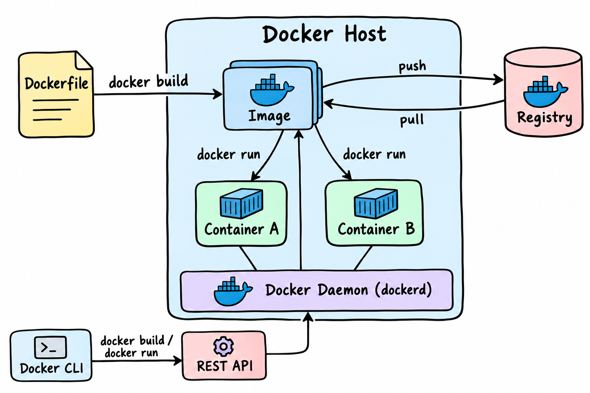
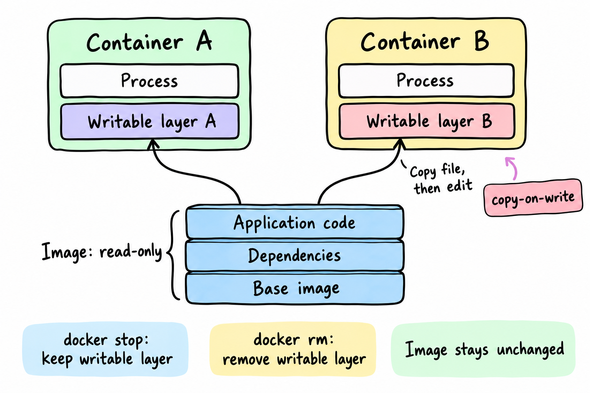
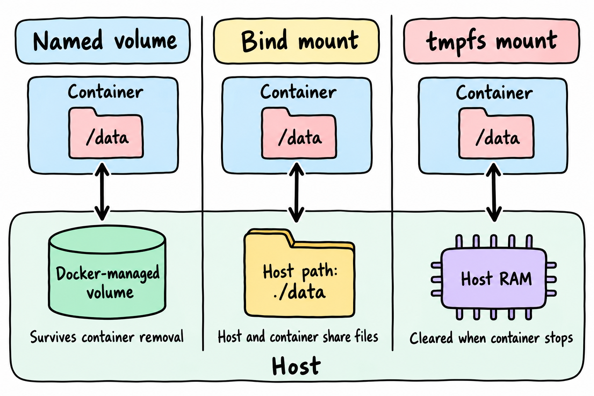
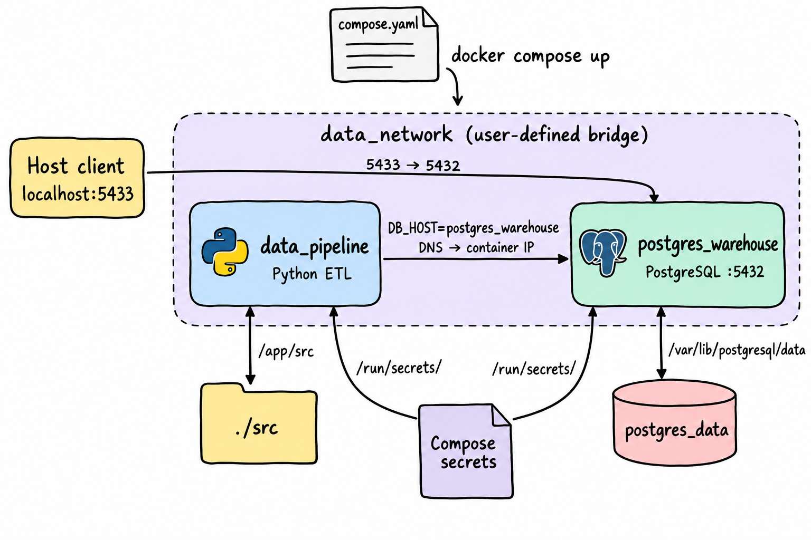

<header class="airflow-article-hero docker-article-hero">
  <div class="airflow-article-hero__eyebrow">
    <a href="../../">BEHIND THE PIPELINE</a>
    <span>ARTICLE / 009</span>
  </div>
  <h1>Docker<br><em>Từ Image đến Container</em></h1>
  <p class="airflow-article-hero__dek">
    Từ Dockerfile, Image và Container đến Docker Engine, lưu trữ,
    kết nối mạng và quản lý ứng dụng nhiều container bằng Docker Compose.
  </p>
  <div class="airflow-article-hero__meta" aria-label="Thông tin bài viết">
    <span>DEVELOPER TOOLS</span>
    <span>EDITION 09 · 2026</span>
  </div>
</header>

## 1. Docker là gì và tại sao cần sử dụng?

**Docker** là một nền tảng mã nguồn mở sử dụng công nghệ ảo hóa ở cấp độ hệ điều hành (**OS-level virtualization**) để đóng gói ứng dụng cùng toàn bộ runtime, thư viện và cấu hình phụ thuộc vào một đơn vị độc lập gọi là **container**.

Container giúp ứng dụng chạy nhất quán trên nhiều môi trường: từ máy tính cá nhân (**local development**), máy chủ staging nội bộ đến các cụm hạ tầng cloud phân tán.

## 2. Dockerfile, Docker Image và Docker Container

### Dockerfile

**Dockerfile** là một tệp văn bản thuần túy với kích thước chỉ vài kilobyte (KB), đóng vai trò như một bản công thức để Docker Engine build một Docker Image hoàn chỉnh.

Một Dockerfile tiêu chuẩn bao gồm các chỉ thị chính sau:

| Chỉ thị | Vai trò |
| --- | --- |
| `FROM` | Định nghĩa base image. Các bước tiếp theo, như `ENV` và `RUN`, được xây dựng trên nền tảng của base image này. |
| `WORKDIR` | Thiết lập thư mục làm việc mặc định trong container cho các lệnh tiếp theo. |
| `ENV` | Khai báo các biến môi trường. |
| `RUN` | Thực thi các lệnh hệ thống. |
| `COPY` | Sao chép tệp, thư mục hoặc tài nguyên từ máy chủ (host) vào không gian thư mục bên trong image. |
| `USER` | Chuyển sang một user khác. |
| `ENTRYPOINT` và `CMD` | Định nghĩa lệnh thực thi mặc định khi container được khởi tạo từ image. |

Cách kết hợp `ENTRYPOINT` và `CMD` có thể được biểu diễn như sau:

```text
Lệnh thực thi hoàn chỉnh = [ENTRYPOINT] + [CMD]
```

Trong đó, `CMD` cung cấp các tham số cho `ENTRYPOINT`.

### Docker Image

**Docker Image** là một bản chụp tĩnh (**snapshot**) hoặc một bản thiết kế (**blueprint**) đóng gói hoàn chỉnh ứng dụng. Đây là kết quả đầu ra khi chạy lệnh `docker build` từ Dockerfile.

Image chứa toàn bộ những gì ứng dụng cần để vận hành, bao gồm mã nguồn (**code**), môi trường thực thi (**runtime**), các thư viện phụ thuộc (**dependencies**), biến môi trường và tệp cấu hình hệ thống.

Một image được cấu thành từ chuỗi các lớp (**layers**) xếp chồng lên nhau. Mỗi layer đại diện cho một thay đổi so với layer trước đó, chẳng hạn thêm tệp, cài thư viện hoặc sửa cấu hình, và ở trạng thái **chỉ đọc (read-only)**. Các layer được hình thành từ image nền và những bước như `RUN`, `COPY`; về mặt lưu trữ, có thể hình dung mỗi layer như một thư mục trên máy chủ.

Docker kiểm tra thay đổi của từng layer theo thứ tự từ trên xuống dưới. Khi một layer thay đổi, các layer phía sau nó phải được xây dựng lại.

Trong các pipeline xử lý dữ liệu, mã nguồn ứng dụng thay đổi liên tục, còn các thư viện phụ thuộc như Pandas, PySpark, SQLAlchemy và DuckDB thường có tần suất cập nhật thấp hơn. Vì vậy, nên sao chép tệp cấu hình thư viện (`requirements.txt`) và cài đặt thư viện bằng `RUN pip install` trước, sau đó mới sao chép mã nguồn ứng dụng bằng `COPY src/ ./src/`.

Dockerfile có thể được quản lý phiên bản bằng Git; các image được chia sẻ qua những kho lưu trữ như Docker Hub.

### Docker Container

**Docker Container** là một thể hiện đang chạy (**running instance**) được khởi tạo từ Docker Image.

Các đặc điểm chính:

- Các container chạy độc lập với nhau.
- Dữ liệu bên trong container mang tính tạm thời và bị mất khi container bị xóa, trừ khi được lưu qua mount.
- Một container thực chất là một tiến trình Linux thông thường (**Linux process**), chạy trực tiếp trên kernel của máy chủ.

### Hình dung qua quy trình làm bánh

Có thể hình dung quy trình này như việc làm bánh:

- **Dockerfile** là tờ công thức ghi chi tiết từng bước: cần nguyên liệu gì, định lượng ra sao và nướng ở nhiệt độ nào.
- **Docker Image** là hộp bột bánh pha sẵn, được đóng gói và niêm phong theo công thức để dễ lưu trữ hoặc gửi đến bất kỳ căn bếp nào.
- **Docker Container** là chiếc bánh thực tế đã được nướng từ hộp bột ấy. Từ một hộp bột chuẩn, bạn có thể tạo ra nhiều chiếc bánh tương tự nhau.

## 3. Docker Registry

**Docker Registry** là hệ thống quản lý, lưu trữ tập trung (**central storage & distribution system**) và phân phối Docker Image. Có thể hình dung registry tương tự GitHub, nhưng dành cho container image thay vì mã nguồn.

### Các khái niệm trong registry

| Khái niệm | Ý nghĩa |
| --- | --- |
| **Registry** | Máy chủ cung cấp dịch vụ lưu trữ. |
| **Repository** | Không gian lưu trữ tập hợp các phiên bản của một loại image cụ thể bên trong registry. |
| **Tag / Image Digest** | Định danh phiên bản cụ thể của image trong repository. |

### Các loại registry

- **Public registry:** Kho lưu trữ công khai, chẳng hạn Docker Hub và GitHub Container Registry.
- **Private registry:** Dùng cho dự án nội bộ nhằm bảo vệ bản quyền mã nguồn, dữ liệu nhạy cảm và đáp ứng các quy định bảo mật doanh nghiệp. Ví dụ: AWS ECR.
- **Self-hosted registry:** Do doanh nghiệp tự triển khai trên hạ tầng riêng. Ví dụ: Docker Registry v2, bản mã nguồn mở do Docker cung cấp.

## 4. Docker Engine

**Docker Engine** là môi trường thực thi (**runtime**) cốt lõi được cài đặt trực tiếp trên máy chủ hoặc máy tính cá nhân. Nó cung cấp hạ tầng để chuyển đổi mã nguồn và tệp cấu hình thành Docker Image, đồng thời điều phối việc vận hành Docker Container.

### Kiến trúc Client–Server

Docker Engine hoạt động theo mô hình **Client–Server**, gồm ba thành phần chính:

- **Docker CLI (client):** Giao diện dòng lệnh cho phép người dùng tương tác qua các lệnh như `docker build`, `docker run` và `docker ps`.
- **Docker REST API:** Giao diện lập trình trung gian, chuyển tiếp chỉ thị từ Docker CLI hoặc công cụ bên ngoài tới Docker Daemon.
- **Docker Daemon (`dockerd`):** Dịch vụ chạy ngầm (**background process**), đóng vai trò xử lý chính của Docker Engine. Daemon lắng nghe yêu cầu từ REST API và trực tiếp quản lý các đối tượng (**objects**) trong Docker.

<figure class="docker-article-figure">
  <a href="../../assets/images/docker/docker-lifecycle.png" title="Xem ảnh kích thước gốc">
    
  </a>
  <figcaption>Hình 1. Dockerfile, image và container trong mô hình hoạt động của Docker Engine.</figcaption>
</figure>

### Quy trình xử lý lệnh `docker run`

Khi người dùng nhập `docker run`, ba thành phần phối hợp như sau:

1. **Tiếp nhận chỉ thị:** Docker CLI đóng gói lệnh thành yêu cầu REST API rồi chuyển đến Docker Daemon qua Unix socket hoặc kết nối mạng.
2. **Kiểm tra image:** Daemon kiểm tra image tương ứng đã có trong kho lưu trữ cục bộ hay chưa. Nếu chưa có, daemon kết nối đến Docker Registry, chẳng hạn Docker Hub, để kéo (**pull**) image về máy.
3. **Khởi tạo container:** Daemon giao tiếp với kernel của hệ điều hành máy chủ để cấp phát tài nguyên phần cứng, thiết lập mạng, mount các volume nếu có và khởi tạo Docker Container.
4. **Trả kết quả:** Thông tin trạng thái vận hành được gửi về Docker Client để hiển thị cho người dùng.

## 5. Writable Layer

Mỗi Docker Image được cấu thành từ các lớp dữ liệu chỉ đọc (**read-only image layers**) xếp chồng lên nhau. Các lớp này ở trạng thái tĩnh và không thể thay đổi sau khi image được tạo.

Khi khởi tạo container từ image bằng `docker run`, Docker Engine bổ sung một lớp mỏng có quyền đọc–ghi (**read-write layer**, hay **writable layer**) lên trên cùng. Lớp này cho phép container thay đổi dữ liệu mà không ảnh hưởng đến image gốc.

Một image có thể được nhiều container sử dụng. Nếu một container sửa trực tiếp image gốc, thay đổi đó sẽ ảnh hưởng tới các container khác. Writable layer giúp tách riêng những thay đổi của từng container.

### Cơ chế sao chép khi chỉnh sửa tệp

Khi tiến trình cần sửa một tệp đã tồn tại trong image layer chỉ đọc, Docker sao chép tệp đó lên writable layer. Việc chỉnh sửa chỉ diễn ra trên bản sao này; tệp gốc trong image layer vẫn được giữ nguyên.

<figure class="docker-article-figure">
  <a href="../../assets/images/docker/image-layers.png" title="Xem ảnh kích thước gốc">
    
  </a>
  <figcaption>Hình 2. Mỗi container có writable layer riêng trên các image layer chỉ đọc.</figcaption>
</figure>

### Vòng đời dữ liệu trong writable layer

Khi container dừng bằng `docker stop`, writable layer vẫn tồn tại. Khi container bị xóa bằng `docker rm`, toàn bộ dữ liệu trong writable layer bị xóa theo.

## 6. Lưu trữ dữ liệu với Mount

Dữ liệu phát sinh trong quá trình vận hành nằm trên writable layer và bị mất khi container bị xóa. Để duy trì dữ liệu bền vững (**persistent storage**) hoặc chia sẻ dữ liệu giữa máy chủ (**host**) và container, Docker cung cấp ba cơ chế mount chính: **Named Volume**, **Bind Mount** và **tmpfs Mount**.

<figure class="docker-article-figure">
  <a href="../../assets/images/docker/storage-mounts.png" title="Xem ảnh kích thước gốc">
    
  </a>
  <figcaption>Hình 3. Named volume, bind mount và tmpfs mount.</figcaption>
</figure>

### Named Volume

**Named volume** được Docker Engine quản lý. Khi container dừng hoặc bị xóa, volume vẫn tồn tại.

Khi khai báo named volume, Docker Engine tạo một thư mục trên host để chứa dữ liệu và quản lý quyền truy cập thư mục đó. Khi container khởi chạy, Docker mount thư mục này vào đường dẫn được chỉ định bên trong container.

Mọi thao tác ghi tại đường dẫn đã mount thực chất ghi trực tiếp vào vùng lưu trữ trên host, thay vì writable layer và cơ chế lưu trữ layer của container. Named volume thường được dùng để duy trì dữ liệu bền vững cho cơ sở dữ liệu.

### Bind Mount

**Bind mount** ánh xạ trực tiếp một tệp hoặc thư mục cụ thể trên host vào không gian lưu trữ của container.

Ví dụ, khi mount thư mục `./data` trên host vào thư mục dữ liệu trong container, các thay đổi đối với tệp trên host sẽ được phản ánh trong thư mục tương ứng của container.

### tmpfs Mount

**tmpfs mount** ghi dữ liệu vào bộ nhớ RAM của host (**host memory**), thay vì writable layer của container. Cơ chế lưu trữ trong RAM cho phép đọc/ghi nhanh; khi container dừng hoặc bị xóa, dữ liệu trên tmpfs được giải phóng và không được giữ lại.

## 7. Docker Networking

Các container hoạt động độc lập, nhưng nhiều ứng dụng cần chúng giao tiếp với nhau. **Docker Networking** là cơ chế ảo hóa mạng cho phép container kết nối với nhau, với hệ điều hành máy chủ (**Host OS**) hoặc với mạng bên ngoài (**Internet / External Network**). Cơ chế này giúp phân tách các nhóm container và tăng khả năng cô lập mạng giữa các dịch vụ.

Khi hai container cùng tham gia một Docker Network, chúng có thể giao tiếp qua mạng nội bộ. Những container thuộc Docker Network khác mặc định không thể kết nối trực tiếp với chúng qua địa chỉ IP nội bộ.

### Kết nối bằng tên container hoặc service

Địa chỉ IP của container có thể thay đổi khi container dừng rồi khởi động lại hoặc khi nhiều container khởi động theo thứ tự khác nhau. Việc ghi cứng (**hardcode**) IP giữa các dịch vụ, chẳng hạn để Python kết nối PostgreSQL qua `172.18.0.3`, vì vậy dễ khiến ứng dụng mất kết nối.

Trong mạng do người dùng tạo, Docker Engine cung cấp DNS nội bộ tại địa chỉ `127.0.0.11`. Các container có thể tìm và kết nối với nhau qua **tên container (container name)** hoặc **tên dịch vụ (service name)** thay vì phụ thuộc vào IP động.

### Bridge Network

**Bridge network** tạo một cầu nối mạng ảo (**virtual bridge**) trên host và cấp địa chỉ IP nội bộ riêng cho từng container. Có hai loại bridge network:

- **Default bridge:** Mạng mặc định khi chạy `docker run` mà không khai báo `--network`. Các container trong mạng này thường giao tiếp với nhau qua địa chỉ IP.
- **User-defined bridge:** Mạng do người dùng tạo hoặc do Docker Compose tự động khởi tạo. Loại mạng này hỗ trợ phân giải DNS tự động để các container giao tiếp bằng tên.

### Host Network

Khi sử dụng bridge network mặc định, Docker đặt container trong một không gian mạng riêng (**network namespace**), tách biệt với máy chủ.

Với **host network** (`--network host`), container dùng chung ngăn xếp mạng (**network stack**) của host. Khi kiểm tra IP từ bên trong container, bạn sẽ thấy địa chỉ IP của host.

### Các network driver khác

| Driver | Đặc điểm |
| --- | --- |
| **None** | Vô hiệu hóa kết nối mạng của container, chỉ giữ giao diện loopback nội bộ (`127.0.0.1`); container không kết nối với Internet hay container khác. |
| **Overlay** | Tạo mạng ảo phân tán, kết nối nhiều Docker Daemon trên các máy chủ vật lý hoặc cloud thành một mạng thống nhất để container trên các host giao tiếp với nhau. |
| **Macvlan** | Gán địa chỉ MAC riêng cho container, giúp container xuất hiện như một thiết bị mạng độc lập. |
| **IPvlan** | Tương tự Macvlan, nhưng container có IP riêng và dùng chung địa chỉ MAC của host. |

## 8. Docker Compose

Khi dự án có nhiều container, việc quản lý các cấu hình riêng lẻ trở nên phức tạp. **Docker Compose** cho phép định nghĩa và điều phối ứng dụng nhiều container (**multi-container application**) thông qua một tệp cấu hình khai báo duy nhất, thường là `docker-compose.yml` hoặc `compose.yaml`.

Thay vì nhập thủ công nhiều lệnh `docker run` với các thiết lập về cổng, mạng, biến môi trường và volume, Docker Compose tập hợp chúng trong một tệp và khởi tạo bằng một lệnh `docker compose up`.

### Ví dụ cấu hình Docker Compose

Cấu hình dưới đây minh họa một pipeline Python và cơ sở dữ liệu PostgreSQL:

```yaml
version: '3.8'

# 1. Định nghĩa Mạng nội bộ
networks:
  data_network:
    driver: bridge

# 2. Định nghĩa Volumes lưu trữ bền vững
volumes:
  postgres_data:
    name: postgres_data

# 3. Định nghĩa Danh sách Dịch vụ
services:
  # Dịch vụ Cơ sở dữ liệu Data Warehouse
  postgres_warehouse:
    image: postgres:15-alpine
    container_name: postgres_warehouse
    environment:
      POSTGRES_DB: warehouse
      POSTGRES_USER_FILE: /run/secrets/db_user
      POSTGRES_PASSWORD_FILE: /run/secrets/db_password
    secrets:
      - db_user
      - db_password
    ports:
      - "5433:5432" # Host Port 5433 -> Container Port 5432
    volumes:
      - postgres_data:/var/lib/postgresql/data # Named Volume
    networks:
      - data_network
    healthcheck: # Kiểm tra trạng thái sẵn sàng
      test: ["CMD-SHELL", "pg_isready -U root -d warehouse"]
      interval: 10s
      timeout: 5s
      retries: 5
    restart: unless-stopped

  # Dịch vụ Pipeline xử lý dữ liệu bằng Python
  data_pipeline:
    build:
      context: .
      dockerfile: Dockerfile
    container_name: python_etl_job
    environment:
      DB_HOST: postgres_warehouse # Kết nối qua Service Name nhờ DNS
      DB_PORT: 5432
    secrets:
      - db_password
    volumes:
      - ./src:/app/src # Bind Mount đồng bộ code
    depends_on:
      postgres_warehouse:
        condition: service_healthy # Chỉ chạy khi DB đã sẵn sàng
    networks:
      - data_network
    deploy:
      resources:
        limits:
          cpus: '2.0'
          memory: 2G # Giới hạn tài nguyên
    restart: on-failure

secrets:
  db_user:
    file: ./secrets/db_user.txt
  db_password:
    file: ./secrets/db_password.txt
```

<figure class="docker-article-figure">
  <a href="../../assets/images/docker/compose-network.png" title="Xem ảnh kích thước gốc">
    
  </a>
  <figcaption>Hình 4. Các dịch vụ, kết nối mạng và vùng lưu trữ trong ví dụ Docker Compose.</figcaption>
</figure>

<footer class="airflow-article-end docker-article-end">
  <div>
    <span>BEHIND THE PIPELINE / 009</span>
    <strong>Hiểu cách đóng gói,<br>chủ động khi triển khai.</strong>
  </div>
  <a href="../../library/">Trở về thư viện <span aria-hidden="true">→</span></a>
</footer>
